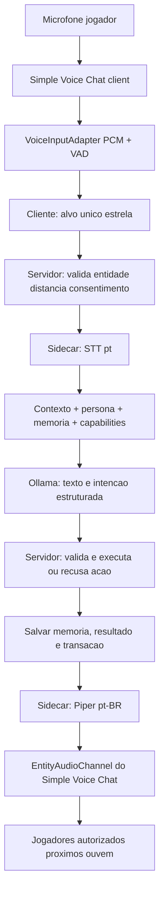

# 04 — Arquitetura técnica e contratos

**Status:** proposta de arquitetura, a ser confirmada por testes e APIs reais em Fabric 1.21.8. Não inventar classes/métodos. Projeto local/sem assinaturas pagas.

## Dependências e versões

- Minecraft Java **1.21.8**, Fabric Loader/Fabric API compatíveis e Java **21**.
- **Simple Voice Chat** (Fabric para 1.21.8), cliente e servidor; capturar áudio pelo `ClientSoundEvent.getRawAudio()` e renderizar via `VoicechatServerApi.createEntityAudioChannel` + `createAudioPlayer`, conforme documentação vigente. Confirmar assinatura e lifecycle no build fixado.
- **Ollama** como back-end local (`127.0.0.1:11434`) com `qwen3:4b-instruct` como candidato de qualidade em pt-BR e `llama3.2` como baseline já instalado. Benchmark antes de escolher definitivo. Alguns modelos Qwen3 oferecem modos thinking; preferir variante **instruct/não-thinking** para conversas rápidas, conforme recursos e medição real.
- **faster-whisper** (STT em `pt`, português; pt-BR na experiência) e **Piper pt_BR** (TTS). Instalação de bibliotecas/modelos após primeira prova de integração.
- **Serviço Python (sidecar)** separado para STT, prompts, validação de JSON e TTS; mod Java não bloqueia thread principal para esperar IA.
- Memória de jogo/persistência no lado servidor (SavedData/equivalente apropriado à versão após validar API); dados persistentes não devem depender do serviço Python para preservar item/identidade.

## Fluxo de conversa dirigida



**Observação de rede:** as bibliotecas SVC separam áudio de jogador (rede de voz) e áudio sintetizado por entidade. Não expor o endpoint de IA publicamente nem retransmitir áudio de jogadores sem consentimento.

## Fluxo de conversa mob-mob

`GameEvent (e.g. attack/offer/mood) -> EventFilter -> Scheduler -> DialoguePlanner -> participantes 2 ou 3 -> LLM uma cena curta OU template -> Validator -> acao permitida -> VoiceQueue espacial`.  
Não chamar Ollama por mob por tick nem instanciar agentes que conversam infinitamente. Priorizar diálogos sob demanda e eventos relevantes.

## Serviços / módulos (responsabilidades)

```text
mod-fabric/
  client/                   alvo pela mira; pequena estrela; consentimento; UI; captura da voz
  common/network/           pacotes tipados, sequence ids, codec, validações
  server/conversation/      coordenador, sessões, fila por mob, interrupção
  server/actions/           proposta, políticas, validators, executors, transaction log
  server/items/             detecção oferta, escrow, pickup e entrega segura
  server/relationships/     confiança, medo, reputação, dívidas, facções
  server/memory/            fatos, identidade persistente, conversão e resumo
  server/social/            scheduler de conversas NPC-NPC e boatos
  server/ai/                estratégias follow, defend, nonhostile e boss adapters
  server/config/            mundo, economia, quantidade de voz, permissões
ai-service/
  app/api.py                /health, /transcribe, /reply, /synthesize
  app/stt.py                faster-whisper local
  app/llm.py                Ollama, temperature, output JSON schema, timeout
  app/tts.py                Piper, voz por identidade, PCM
  app/prompts.py            contexto pt-BR, regras por espécie, sem fatos inventados
  app/validation.py         schema, idioma, tamanho da resposta
  tests/                    stubs/mocks e teste real opcional
config/
  action_contract.schema.json
  mob_profiles.sample.json
  balance.sample.json
```

**Thread safety:** I/O e LLM em executores limitados; qualquer alteração de entidade/inventário/world no thread de servidor correspondente; fila bounded; cancellation tokens; o log registra o resultado **depois** da validação; salvar idempotentemente por `transactionId`.

## Modelo de dados sugerido

```text
MobIdentity {
  identityId: UUID estável; entityUuid: UUID atual; lineageId: UUID?
  entityType, profileId, profession, traits, voiceProfileId
  relationshipsByPlayer: { playerUUID -> Relationship }
  episodicMemory: Evento[] (limite + compressao)
  allegiance: {faction, leader?, expiration?, rules}
  activeContractIds: string[]
}
WorldEvent {
  eventId, tick, dimension, position, actors[], type, payloadValidated,
  visibilityClass, factionAudience[], factOrRumor
}
TradeTransaction {
  transactionId, contractId, playerUUID, mobIdentityId,
  state: PROPOSED | OFFERED | RESERVED | COMPLETED | RETURNED | EXPIRED,
  inputItems[], outputItems[], createdAtTick, expiry, dedupeKey
}
ConversationSession {
  utteranceId, targetEntityUUID, playerUUID, dimension,
  state, startedAtTick, inputLanguage: pt-BR, maxDurationMs
}
```

Persistir somente quando necessário e usar versionamento de esquema + migrações para não perder saves em atualizações do mod.

## Contrato LLM → motor de jogo

Entrada ao LLM sempre inclui `capabilities[]` e o estado relevante verificado. **Somente o servidor determina essas capacidades.** A IA devolve `speech_text` em pt-BR, `emotion`, `intention`, `action_proposal`, com parâmetros limitados. O contrato JSON de exemplo está em `../config/action_contract.schema.json`.

Exemplo ilustrativo:

```json
{
  "speech_text": "Traga oito barras de ouro e podemos negociar.",
  "language": "pt-BR",
  "emotion": "calculista",
  "intent": "negociar",
  "action_proposal": {
    "type": "OFFER_TRADE",
    "parameters": {"recipe_id": "wither_skeleton_gold_skull_v1"}
  }
}
```

Regras obrigatórias:

1. Ao validar, confirmar: espécie, ação permitida, alvo existente, distância, relacionamento, custo, dimensão, combate/estado, receita e budget.
2. Salvar resultado da transação antes de dizer “feito”.
3. Se não tiver receita autorizada para cabeça rara, recusar ou propor outro favor.
4. Nunca aceitar `minecraft:give`, `kill`, comandos de servidor, paths, URLs nem código arbitrário retornado pelo modelo.
5. Não permitir que dados de mundo, nomes de jogador ou mensagens manipulem instruções do sistema (injection); são entradas não confiáveis, não regras.
6. `language` / fala só `pt-BR`; se sair inglês, corrigir com retry limitado e fallback curto em português.
7. Validar tamanho, número máximo de ações, timestamps, IDs, e diversidade antes de executar.

## Pseudocódigo crítico de execução

```text
onPlayerUtterance(player, target, transcript):
  assert player.consent and transcript.duration <= max
  assert server.raycastValidTarget(player, target, distance <= max)
  acquire sessionLock(target.identityId)
  context = buildVerifiedWorldContext(player,target)
  proposal = sidecar.llmReply(context, transcript, allowedCapabilities(target))
  response = parseStrictSchema(proposal)
  if response.action != NONE:
      decision = validatePolicy(response.action, serverState)
      if decision.requiresAcceptance: presentOffer()  # voz/UI opcional
      else if decision.allowed: executeAtomicallyAndLog(decision)
      else: markRejected(decision.reason)
  updateVerifiedEventMemory()
  speakViaEntityChannel(target, voiceReplyWithActualResult())
  release lock
```

A fala inicial pode ser gerada antes da conclusão apenas como proposta condicional (“posso negociar...”), nunca afirmando que a recompensa já foi entregue.

## STT/TTS e áudio espacial

- Cliente `ClientSoundEvent.getRawAudio()` expõe 16-bit PCM antes do envio; verificar escopo, permissão, thread e eventos de término. Não alterar áudio enviado ao SVC por padrão.
- VAD segmenta fala, ignora silêncio, impõe duração máxima e impede disparo para todos os mobs.
- Enviar apenas o trecho necessário ao sidecar em localhost (ou servidor de IA autorizado no modo multiplayer), com autenticação e limite de tamanho. Descartar áudio bruto após processamento, salvo configuração explicitamente habilitada para depuração.
- `faster-whisper` usa código de idioma `pt` — não `pt-BR` na API — e pode usar CPU com modelo pequeno, GPU se disponível.
- `Piper` pt_BR possui vozes de amostra como `cadu`, `faber`, `jeff`, `edresson`; conferir licenças de cada artefato e comparar qualidade.
- SVC `createEntityAudioChannel` reproduz voz na posição real do mob; codificar PCM na frequência/formato oficial e respeitar ciclo de vida/cancelamento da conexão.
- Estrelas/UI são feedback; não exigem clicar para falar.

## Contratos HTTP provisórios

- `GET /health` retorna status dos serviços e modelo ativo.
- `POST /v1/transcribe` recebe WAV/PCM com limites e devolve transcrição + duração/confiança.
- `POST /v1/reply` recebe contexto verificado + mensagem e devolve JSON estrito.
- `POST /v1/synthesize` recebe texto pt-BR e voz autorizada e devolve WAV/PCM.
- Pode migrar para streaming após MVP com HTTP simples funcionando.
- API liga **somente** em `127.0.0.1` por padrão. Nunca expor Ollama/sidecar na internet sem projeto específico de autenticação/segurança.

## Limitações assumidas

- Modelo local pequeno pode produzir respostas incoerentes, redundantes ou latência perceptível: benchmark no PC real antes de expansão para todas as espécies.
- IA local não é grátis em termos de recursos computacionais.
- Voice chat entre mobs é um **componente novo**: Simple Voice Chat cuida transporte, não decide alvo, personalidade, economia ou STT. É nosso código que fará isso.
- Compatibilidade com bosses, passagens entre dimensões e conversas simultâneas precisam de adaptadores/testes, não são características automáticas da API.

## Adendo arquitetural v2.1 — crenças, papéis e controlador universal

Adotar estruturas distintas e persistentes: `VerifiedEvent`, `PlayerClaim`, `NpcBelief`, `Relationship`, `FollowOrder` e `EntityIdentity`. Exemplo de dados: `config/social_state.sample.json` **não é implementação**. Uma mudança de identidade (conversão) deve migrar relações e memórias com evento comprovado, não copiar ao acaso. Transição de crença proposta pelo LLM é validada e persistida pelo servidor; a pessoa pode mentir e ser acreditada, sem alterar história factual.

Criar **um controlador social universal** para solicitações e relações e **adaptadores de ação por categoria de entidade** (andar, voar, nadar, bosses, portais). Casos não suportados retornam recusa narrativa e não afirmam sucesso. Garantir prioridade de ordens e consistência multiplayer. A API de ações deve evoluir de maneira versionada, sem prometer que `action_contract.schema.json` já suporte todas as intenções futuras.

**Contratos JSON:** `config/action_contract.schema.json` permanece protótipo para ação simples. `config/social_action_proposal.schema.json` é **rascunho v2.1**, não um esquema de segurança completo: parâmetros genéricos exigem *subschemas* rígidos por ação, IDs válidos e validação de mundo/permissão no servidor. Nenhum dos JSON deve ser tratado como executável.
